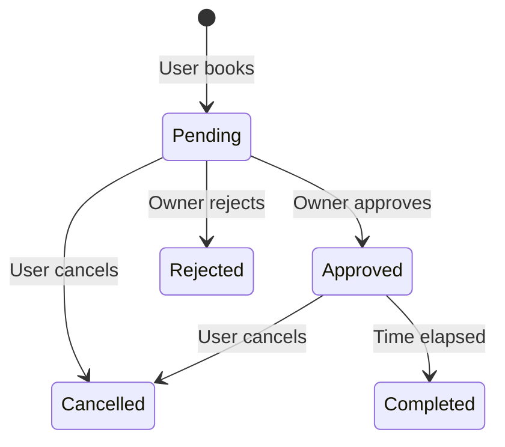

# Riyada (رياضة) — Database Schema & ERD

> **Version:** 1.0  
> **Scope:** Users, Owners, Fields, Bookings, Transactions  
> **Currency:** IQD — store amounts as integers

---

## 1. Design Principles

| Principle | Decision |
|-----------|----------|
| Identity | Single `Users` table with role; owner data in `OwnerProfiles` |
| Fields | Renamed from `Stadium` → `Field` (ملعب) |
| Money | `int` amounts in IQD — never float |
| Commission | **10% of (price per hour × hours booked)** per approved booking |
| Audit | `Transactions` is append-only ledger |
| Security | `PasswordHash` only — never plain text |
| Time | UTC in DB; `Asia/Baghdad` in UI |

---

## 2. Entity Relationship Diagram

```mermaid
erDiagram
    Users ||--o| UserProfiles : has
    Users ||--o| OwnerProfiles : has
    Users ||--o{ Fields : owns
    Users ||--o{ Bookings : creates
    Users ||--o{ Notifications : receives

    Provinces ||--o{ UserProfiles : located_in
    Provinces ||--o{ Fields : located_in

    Fields ||--o{ Bookings : receives
    Fields ||--o{ FieldSchedules : has

    Bookings ||--o{ Transactions : generates
    Bookings ||--o{ Notifications : triggers

    Users {
        guid Id PK
        string Email UK
        string PasswordHash
        enum Role
        bool IsActive
        datetime CreatedAt
    }

    UserProfiles {
        guid UserId PK_FK
        string FullName
        string Phone
        int ProvinceId FK
        string ProfileImageUrl
    }

    OwnerProfiles {
        guid UserId PK_FK
        enum VerificationStatus
        datetime VerifiedAt
    }

    Fields {
        guid Id PK
        guid OwnerId FK
        string Name
        int PricePerHour
        time OpenTime
        time CloseTime
    }

    Bookings {
        guid Id PK
        guid UserId FK
        guid FieldId FK
        datetime StartTimeUtc
        int DurationHours
        enum Status
        int SubtotalAmount
        int AppFeeAmount
        int OwnerNetAmount
    }

    Transactions {
        guid Id PK
        guid BookingId FK
        enum Type
        int Amount
        enum Status
    }

    Notifications {
        guid Id PK
        guid UserId FK
        guid BookingId FK
        enum Type
        string Title
        bool IsRead
    }
```

---

## 3. Financial Rules

| Event | Subtotal | App Fee | Owner Net |
|-------|----------|---------|-----------|
| Booking created (Pending) | calculated | 0 | 0 |
| Owner approves | frozen | **2,000** | Subtotal − 2,000 |
| Owner rejects | — | 0 | 0 |
| User cancels (>24h) | — | refund if paid | — |

### Owner Dashboard SQL

```sql
SELECT
  SUM(SubtotalAmount)  AS TotalRevenue,
  SUM(AppFeeAmount)    AS AppCommission,
  SUM(OwnerNetAmount)  AS NetRevenue
FROM Bookings
WHERE FieldId = @fieldId AND Status = 'Approved';
```

---

## 4. Booking State Machine



**Rules:** Duration 1–2 hours only. Cancel only if ≥ 24h before start.

---

## 5. Legacy → New Mapping

| Current | Proposed |
|---------|----------|
| `User` | `Users` + `UserProfiles` |
| `User.Password` plain | `Users.PasswordHash` |
| `Stadium` | `Fields` |
| `Booking.TotalPrice` | `SubtotalAmount` + `AppFeeAmount` + `OwnerNetAmount` |
| *(missing)* | `Transactions` |
| `Province` string | `Provinces` table |

---

## 6. Security Checklist

- Hash passwords (BCrypt / ASP.NET Identity)
- JWT tokens — never pass UserId in body
- Owner can only approve own field bookings
- DB transaction + row lock on slot booking
- Idempotency key on POST /bookings
- HTTPS + restricted CORS in production
